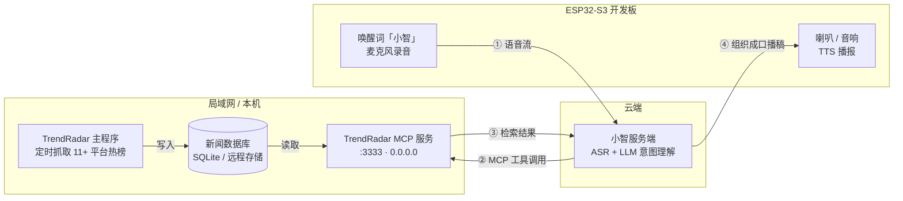

<div align="center" id="top">

# TrendRadar-with-ESP32S3-Xiaozhi

**给热点新闻监控装上「耳朵」和「嘴巴」**

在 [TrendRadar](https://github.com/sansan0/TrendRadar) 的基础上，接入 ESP32-S3 + 小智语音助手，
让你可以**开口问新闻**："小智，今天有什么 AI 新闻？" —— 不用掏手机，不用刷 App。

[](https://github.com/sansan0/TrendRadar)
[](https://modelcontextprotocol.io/)
[](https://www.espressif.com/)
[](LICENSE)

**中文** | 二次开发项目 | [上游仓库](https://github.com/sansan0/TrendRadar) | [快速开始](#-快速开始) | [常见问题](#-常见问题)

</div>

---

## 📌 这是什么

[TrendRadar](https://github.com/sansan0/TrendRadar) 是一个很成熟的开源热点聚合工具：自动抓取 11+ 平台热榜、按关键词筛选、推送到企业微信 / 飞书 / 邮件等渠道。**但它只"看"不"说"** —— 信息仍然要你在手机屏幕上读。

本项目在它之上加了一层**语音交互**：

| | 原 TrendRadar | 本项目 |
|---|---|---|
| 获取方式 | 推送到手机，自己看 | **语音问答，开口即得** |
| 交互形态 | 被动接收推送 | 主动提问、多轮对话 |
| 输出形式 | 文字 / HTML 报告 | TTS 语音播报 |
| 数据链路 | 采集 → 筛选 → 推送 | 采集 → 入库 → **MCP 服务** → 大模型 → 语音 |
| 硬件 | 无 | ESP32-S3（麦克风 + 喇叭） |

**典型场景**

- 早上洗漱时："小智，今天有什么科技新闻？"
- 出门前："小智，最近 AI 相关的热点有哪些？"
- 做饭时："小智，帮我看看今天微博热搜前十。"

> 💡 一句话概括：**TrendRadar 负责"知道"，ESP32-S3 负责"说出来"。**

---

## 🧩 系统架构



### 一次提问，实际发生了什么

| 步骤 | 发生位置 | 说明 |
|:---:|---|---|
| ① | ESP32-S3 | 听到"小智"唤醒 → 录音 → 音频流上传云端 |
| ② | 小智服务端 | ASR 转文字 → LLM 理解意图，判断"要查新闻" |
| ③ | 云端 → 你的机器 | LLM 通过 **MCP 协议**调用 `search_news` / `get_latest_news` 等工具 |
| ④ | 你的机器 | MCP 服务检索本地新闻库，返回标题、平台、排名、时间 |
| ⑤ | 小智服务端 | LLM 把结构化结果改写成**口语播报稿** |
| ⑥ | ESP32-S3 | TTS 合成语音 → 喇叭播报 |

> ⚠️ **注意第 ③ 步**：MCP 调用是**云端发起**的，不是 ESP32-S3 直连你的电脑。这一点决定了部署方式，详见 [关键前提](#-关键前提云端必须够得着你的-mcp)。

---

## ⚠️ 关键前提：云端必须够得着你的 MCP

这是本项目**唯一需要动脑的部署环节**，也是最容易卡住的地方。

小智的 MCP 调用由云端服务端发起，所以云端服务器必须能访问到你跑 MCP 服务的地址：

| 你的情况 | 能不能用 | 怎么办 |
|---|:---:|---|
| MCP 服务监听 `127.0.0.1` | ❌ 云端访问不到 | 改成 `0.0.0.0`（[见步骤 3](#3️⃣-启动-mcp-服务并放开局域网访问)） |
| MCP 服务监听 `0.0.0.0`，只有局域网 IP（`192.168.x.x`） | ❌ 云端仍访问不到 | **必须做内网穿透** |
| 用 frp / cpolar / natapp 暴露成公网 HTTPS 地址 | ✅ | 推荐方案，[见步骤 4](#4️⃣-把-mcp-服务暴露到公网) |
| MCP 服务跑在云服务器 / 有公网 IP 的 NAS | ✅ | 直接填公网地址 |
| 自建小智服务端（`xiaozhi-server` 部署在本地） | ✅ | 直接填局域网地址即可 |

> 📌 如果你用的是**官方小智后台**，请直接跳到 [步骤 4](#4️⃣-把-mcp-服务暴露到公网)，内网穿透是必须的。

---

## 🚀 快速开始

### 前置条件

- Python 3.10+，[uv](https://github.com/astral-sh/uv)（推荐）或 pip
- 一块 ESP32-S3 开发板（建议带 **PSRAM**，如 ESP32-S3-DevKitC-1-N8R8）
- 麦克风（INMP441 或板载）+ 喇叭（MAX98357A 或 4Ω 3W 喇叭 + 功放）
- 已注册小智账号并能正常对话（先确保"小智"本身能聊天，再接 MCP）

### 1️⃣ 部署 TrendRadar 主体

先把上游项目跑通。**这一步请严格照上游文档做**，本项目不改变它的任何行为：

```bash
git clone https://github.com/sansan0/TrendRadar.git
cd TrendRadar
```

配置两个核心文件：

| 文件 | 作用 |
|---|---|
| `config/config.yaml` | 平台列表、推送模式、存储方式、AI 分析开关 |
| `config/frequency_words.txt` | 你关心的关键词（**决定小智能答出什么**） |

> 📖 上游完整文档：[TrendRadar README](https://github.com/sansan0/TrendRadar?tab=readme-ov-file)

**至少让它跑 1 天**，让数据库里积累足够的新闻数据 —— MCP 查的是**已入库的历史数据**，不是实时联网搜索。

### 2️⃣ 确认数据已入库

```bash
# Docker 部署
docker exec -it trendradar python manage.py files

# 本地部署
ls output/
```

看到按日期归档的数据库文件，说明数据就绪。

### 3️⃣ 启动 MCP 服务并放开局域网访问

TrendRadar 自带 MCP 模块（`mcp_server/`），可作为新闻数据的查询接口。

```bash
# 默认只监听 127.0.0.1，这里必须改成 0.0.0.0
uv run python -m mcp_server.server --transport http --port 3333 --host 0.0.0.0
```

> 若当前版本不支持 `--host` 参数，可用反向代理代替：
> ```bash
> # nginx 片段
> location /mcp {
>     proxy_pass http://127.0.0.1:3333;
>     proxy_http_version 1.1;
>     proxy_set_header Upgrade $http_upgrade;
>     proxy_set_header Connection "upgrade";
> }
> ```

**同时放行防火墙**（否则局域网内其它机器和设备访问不到）：

```powershell
# Windows（管理员 PowerShell）
New-NetFirewallRule -DisplayName "TrendRadar MCP" -Direction Inbound -LocalPort 3333 -Protocol TCP -Action Allow
```

```bash
# Linux
sudo ufw allow 3333/tcp
```

**验证**：在另一台设备上执行，能返回说明 OK：

```bash
curl http://<你的局域网IP>:3333/mcp
```

### 4️⃣ 把 MCP 服务暴露到公网

选一种方式拿到公网地址（假设结果为 `https://your-domain.example.com/mcp`）：

```bash
# 示例：cpolar
cpolar http 3333

# 示例：frpc.toml
[[proxies]]
name = "trendradar-mcp"
type = "http"
localIP = "127.0.0.1"
localPort = 3333
customDomains = ["your-domain.example.com"]
```

> 💡 穿透地址建议配 HTTPS —— 部分云端 MCP 客户端会拒绝明文 HTTP 端点。

### 5️⃣ 在小智后台配置 MCP

1. 打开小智控制台 → 找到 **MCP 服务 / 自定义 MCP** 配置项
2. 新增一个服务：

```json
{
  "mcpServers": {
    "trendradar": {
      "url": "https://your-domain.example.com/mcp",
      "type": "streamableHttp"
    }
  }
}
```

3. 保存后**重启 ESP32-S3**（让设备重新拉取配置）
4. 对着板子说：**"小智，今天有什么热门新闻？"**

> 如果设备端支持在配置文件里写 MCP，也可以直接写入固件的 MCP 配置段。

### 6️⃣ 让小智说得更像"新闻播报"（可选但强烈建议）

默认大模型容易「念列表」，加上角色设定后播报效果好很多。在小智后台的**角色设定 / System Prompt** 中追加：

```text
你可以调用 trendradar 工具查询本地热点新闻库。请注意：
1. 只播报工具返回的新闻，严禁自行编造任何新闻标题、来源或数据；查不到就直说"暂时没有找到相关新闻"。
2. 一次最多播报 3-5 条，每条只说标题 + 来源平台，控制在 20 字以内概括。
3. 用口语化的口播方式："今天有 3 条值得关注的新闻：第一条……"，不要用 Markdown、不要念编号符号。
4. 用户问"今天"时，先调用日期解析工具确认日期范围，再检索。
5. 如果用户问得很模糊（比如"有什么新闻"），默认取热度最高的几条。
```

---

## 🎙️ 你可以这样问

底层能力来自 TrendRadar MCP 的 21 个工具，常用的有：

| 工具 | 能干什么 | 你可以这么说 |
|---|---|---|
| `get_latest_news` | 查最新一批热榜 | "小智，今天有什么新闻？" |
| `search_news` | 按关键词检索 | "小智，帮我查查 AI 相关的热点" |
| `get_trending_topics` | 话题热度排行 | "小智，现在什么话题最火？" |
| `analyze_topic_trend` | 话题趋势变化 | "小智，比亚迪的热度最近怎么样？" |
| `get_news_by_date` | 按日期查询 | "小智，昨天有哪些科技新闻？" |
| `compare_periods` | 周期对比 | "小智，这周比上周哪类新闻变多了？" |
| `get_latest_rss` | RSS 订阅源 | "小智，我的订阅源有什么更新？" |

> 具体参数以 `mcp_server` 实际暴露的工具为准，可用 [MCP Inspector](https://github.com/modelcontextprotocol/inspector) 检查：
> ```bash
> npx @modelcontextprotocol/inspector
> ```

---

## 🔧 关键词：决定小智能答出什么

MCP 查的是**已经入库的新闻**。如果 `frequency_words.txt` 里没有配置某类关键词，这类新闻根本不会进库，小智自然答不出来。

```txt
# config/frequency_words.txt 示例
[GLOBAL_FILTER]
广告
推广

[WORD_GROUPS]
AI
人工智能
大模型
+技术

比亚迪
特斯拉
+销量
```

| 语法 | 作用 | 示例 |
|---|---|---|
| 普通词 | 包含任意一个即命中 | `人工智能` |
| `+必须词` | 必须同时包含 | `+技术` |
| `!过滤词` | 命中则排除 | `!广告` |
| `@数字` | 限制显示条数 | `@5` |
| `/正则/` | 精确匹配 | `/\bai\b/` |
| `=> 备注` | 自定义显示名 | `/\bai\b/ => AI相关` |

> 📖 完整语法见[上游文档 - 关键词配置](https://github.com/sansan0/TrendRadar?tab=readme-ov-file#2-我关心什么内容)

---

## 🧰 硬件清单与接线

| 器件 | 推荐型号 | 说明 |
|---|---|---|
| 主控 | ESP32-S3-DevKitC-1（N8R8） | **建议带 PSRAM**，语音缓冲更稳 |
| 麦克风 | INMP441（I2S） | 也可选用板载麦克风的开发板 |
| 功放 | MAX98357A（I2S） | 直接驱动 4Ω 3W 喇叭 |
| 喇叭 | 4Ω 3W | |
| 其它 | 杜邦线、USB-C 线、可选 3D 打印外壳 | |

```text
ESP32-S3          INMP441          MAX98357A
GPIO4    <---->   SCK  (BCLK)
GPIO5    <---->   WS   (LRCL)
GPIO6    <---->   SD   (DOUT)
GPIO7    ------------------------>  DIN
GPIO15   ------------------------>  BCLK
GPIO16   ------------------------>  LRC
3V3 / GND --------------------------------> 共地
```

> ⚠️ 引脚以你使用的**小智固件版本**为准，请先照固件文档把基础语音对话跑通，再接 MCP。

---

## ❓ 常见问题

<details>
<summary><strong>Q1：小智回答"没有找到相关新闻"，但推送里有新闻</strong></summary>

按这个顺序排查：

1. **数据库里有没有数据** —— MCP 查历史库，不联网。确认 `output/` 下有对应日期的数据。
2. **日期范围对不对** —— 让模型先调 `resolve_date_range` 确认日期，再检索。
3. **关键词命中了吗** —— `frequency_words.txt` 没配置的词，库里就没有对应新闻。
4. **MCP 连上了吗** —— 看小智后台的 MCP 调用日志，确认工具确实被调用。

</details>

<details>
<summary><strong>Q2：云端连不上我的 MCP 服务</strong></summary>

这是最常见的问题，逐项检查：

- [ ] MCP 服务监听的是 `0.0.0.0` 而不是 `127.0.0.1`
- [ ] 防火墙已放行 3333 端口
- [ ] 穿透/公网地址在**手机流量网络**下也能访问（别只在局域网内自测）
- [ ] 地址是 HTTPS（部分云端客户端拒绝明文 HTTP）
- [ ] 电脑休眠会断掉穿透 —— 关闭休眠或改用云服务器

</details>

<details>
<summary><strong>Q3：响应很慢，要等十几秒</strong></summary>

语音链路本身有固定开销（唤醒 → 上传 → ASR → LLM → 工具调用 → LLM → TTS）。优化方向：

- 在角色设定里限制**只检索最近 1 天、最多 10 条**，减少工具返回体积
- 降低 `AI_MAX_TOKENS`，缩短 LLM 二次生成时间
- 用响应更快的模型
- 检查穿透链路延迟（免费穿透服务通常较慢）

</details>

<details>
<summary><strong>Q4：小智会编造新闻</strong></summary>

这是大模型幻觉，不是 MCP 的问题。缓解办法：

- 角色设定里写死「只播报工具返回的内容，查不到就说没有」
- 只开放**检索类**工具，不开放生成类工具
- 事实性查询交给工具、表达与归纳交给模型 —— 这也是本项目设计链路的核心原则

</details>

<details>
<summary><strong>Q5：能同时保留原来的推送功能吗</strong></summary>

能，完全不冲突。TrendRadar 主程序照常定时抓取和推送，MCP 服务只是**额外读取**同一个数据库。两者可以跑在同一台机器上。

</details>

<details>
<summary><strong>Q6：Docker 环境下怎么起 MCP</strong></summary>

上游提供了独立镜像 `wantcat/trendradar-mcp`：

```bash
docker compose up -d trendradar-mcp
```

默认监听 `127.0.0.1:3333`，需要公网访问时请在 `docker-compose.yml` 中把端口映射改为 `0.0.0.0:3333:3333`。

</details>

---

## 🗺️ 开发计划

- [x] TrendRadar 主体部署 + 关键词筛选
- [x] 企业微信定时推送
- [x] MCP 服务封装新闻检索能力
- [x] ESP32-S3 小智语音问答闭环
- [ ] 播报结果的用户反馈收集（满意度 / 准确率统计）
- [ ] 常用问句缓存，降低重复提问的延迟与 token 消耗
- [ ] 支持"订阅频道"式语音指令（"小智，以后每天早上给我播报 AI 新闻"）
- [ ] 查询失败的兜底话术优化

---

## 🙏 致谢与许可

本项目基于以下开源项目二次开发，**在此郑重感谢**：

| 项目 | 用途 | 许可 |
|---|---|---|
| [sansan0/TrendRadar](https://github.com/sansan0/TrendRadar) | 热点采集、筛选、推送与 MCP 服务 | GPL-3.0 |
| [ourongxing/newsnow](https://github.com/ourongxing/newsnow) | 多平台热榜数据源 | 见原项目 |
| 小智 ESP32-S3 语音助手固件 | 语音唤醒 / ASR / TTS 端侧能力 | 见原项目 |

- **许可证**：本项目沿用 **GPL-3.0**（与上游保持一致），完整文本见 [LICENSE](LICENSE)。
- **数据来源**：热榜数据来自 newsnow 提供的公开 API，请合理使用、控制抓取频率，别给上游服务器添麻烦。
- 若在您的工作中参考了本仓库，欢迎在文档中注明来源 —— 开源生态靠互相尊重维系。

---

<div align="center">

如果这个项目对你有启发，欢迎点个 ⭐

[🔝 回到顶部](#top)

</div>
